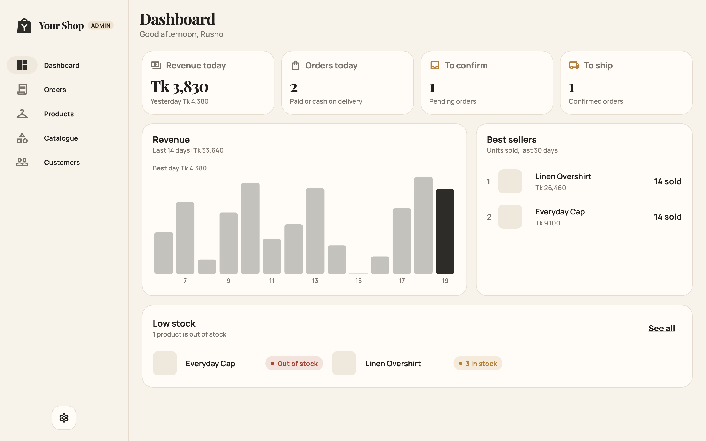
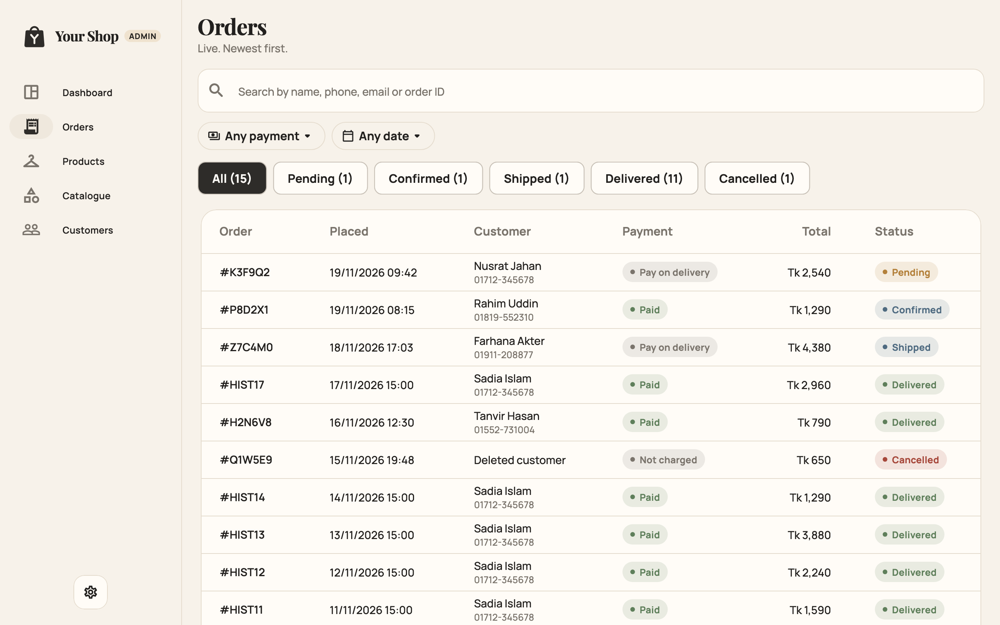
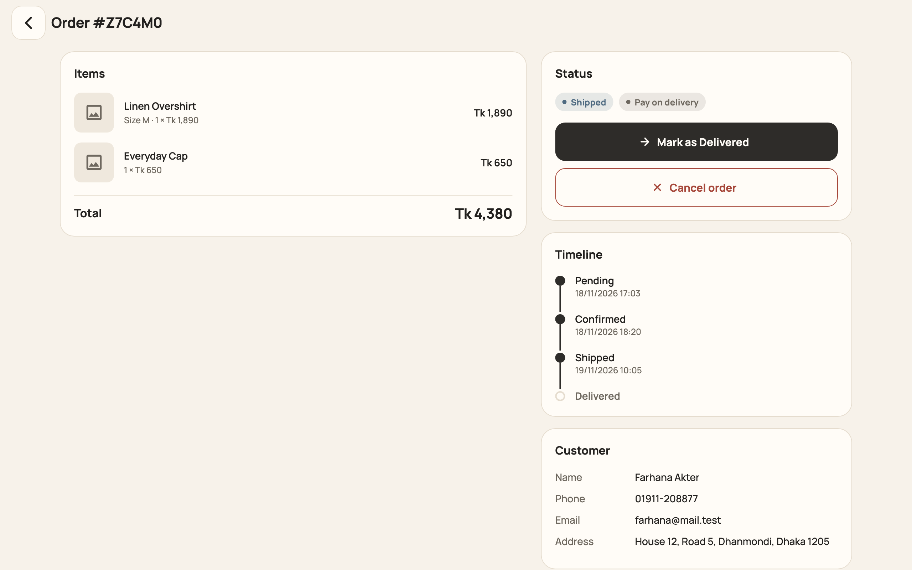
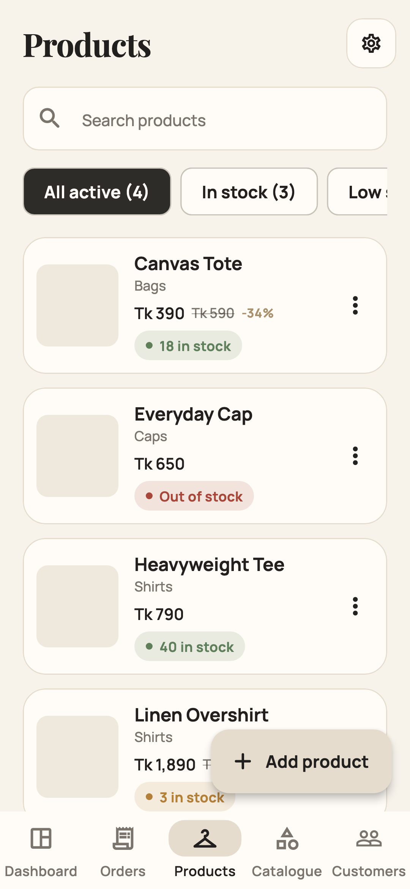
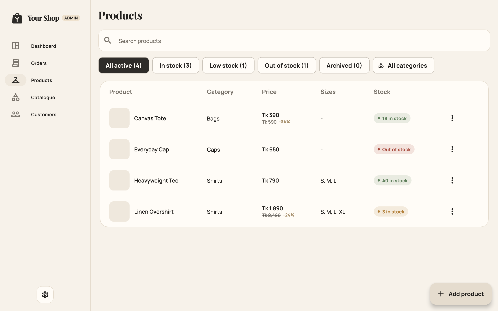
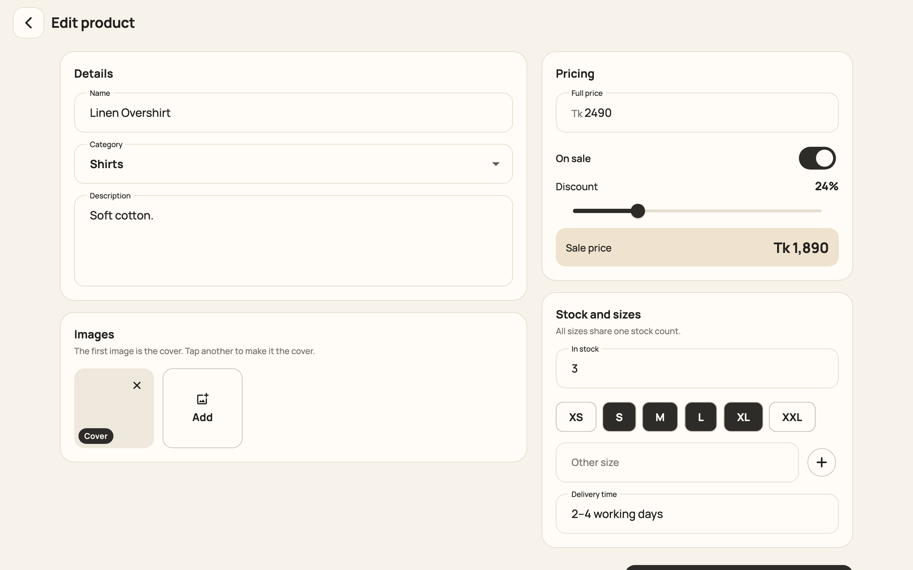
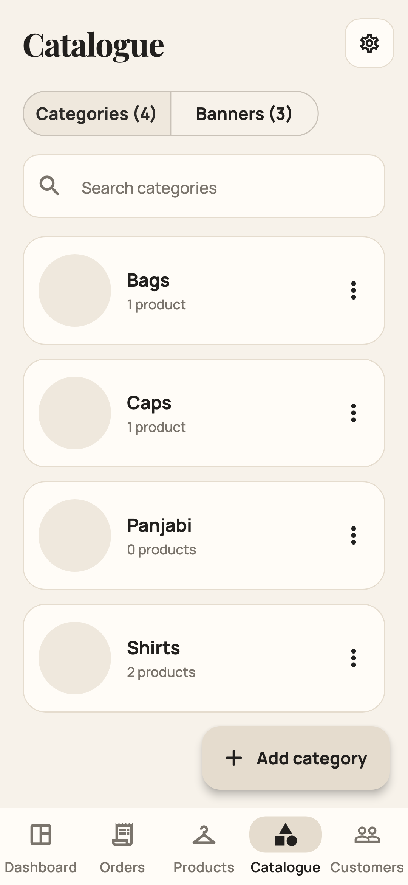
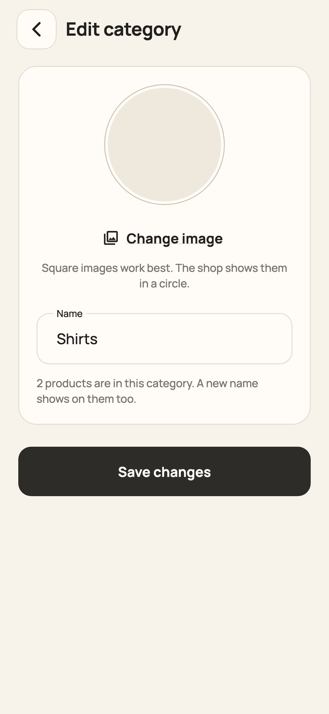
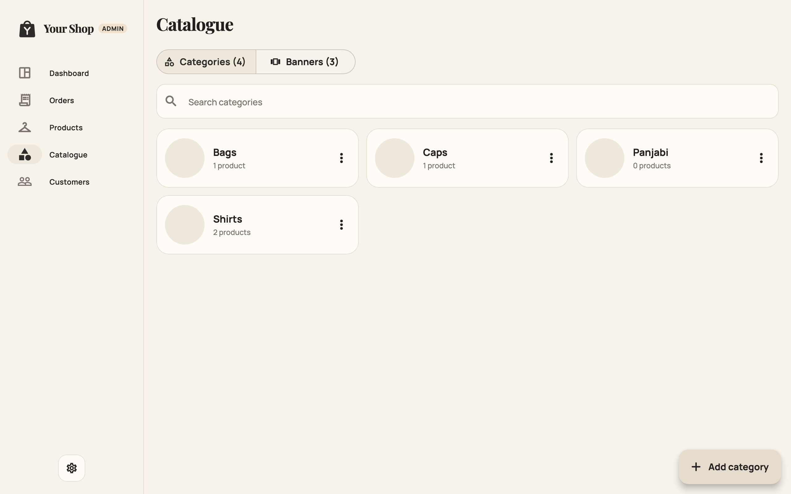
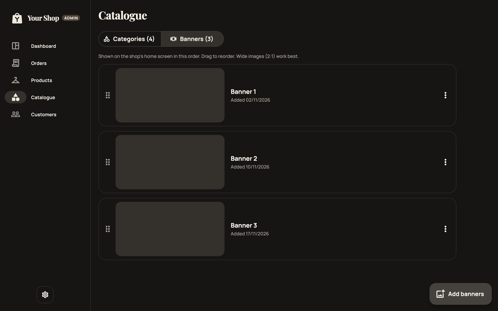

# Your Shop Admin

Admin panel for the **Your Shop** store (Bangladesh, BDT). Flutter, GetX
(MVVM), Firebase. Runs on Android, iOS and the web; tablets and browsers
get a side rail, phones get a bottom bar.

It shares the Firebase project `nabilrayhanshopping` with the customer app
(`UTM_clothing_app`), which owns `firestore.rules`, `storage.rules` and the
Cloud Functions. Only accounts with `users/{uid}.isAdmin == true` can sign in.



| Sign in | Dashboard (phone) | Settings |
|---|---|---|
|  |  |  |

| Orders | Order detail |
|---|---|
|  |  |




| Products | Product form |
|---|---|
|  |  |




| Categories | Banners | Category form |
|---|---|---|
|  |  |  |




## Run

```sh
cp env/example.json env/dev.json   # git-ignored; fill in values
flutter run --dart-define-from-file=env/dev.json
flutter run -d chrome --dart-define-from-file=env/dev.json
```

## Check

```sh
dart format --output=none --set-exit-if-changed lib test tool
flutter analyze
flutter test
flutter test tool/screenshots_test.dart --update-goldens   # golden PNGs
```

## Layout

```
lib/app/      app, routes, bindings, middlewares (AdminMiddleware)
lib/core/     config, constants, errors, services, theme, utils, widgets, i18n
lib/data/     models, repositories (Firestore only, injectable fakes)
lib/modules/  <feature>/view_models, views, bindings
```

Plan and progress: [docs/ROADMAP.md](docs/ROADMAP.md).
