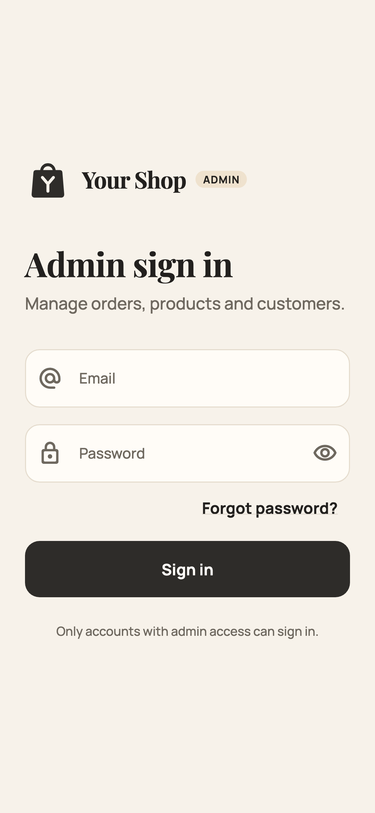
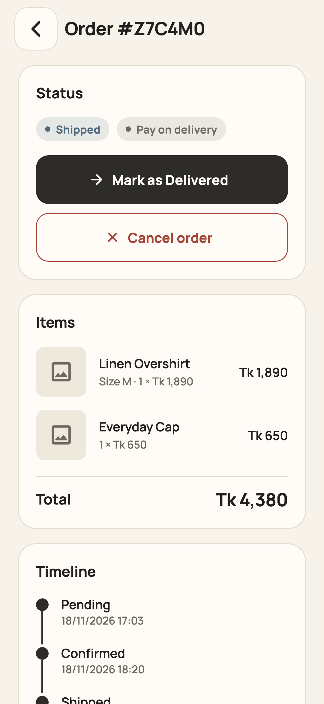
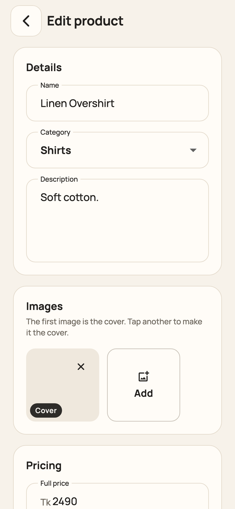
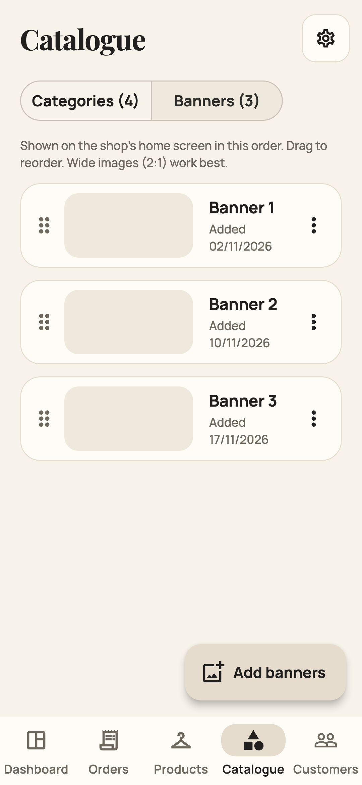
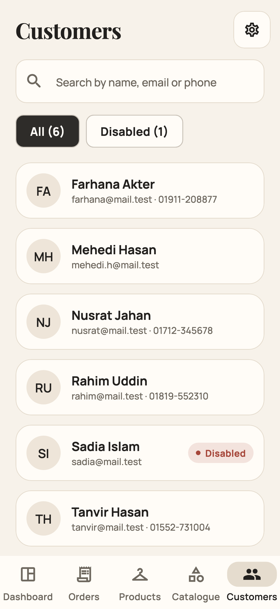
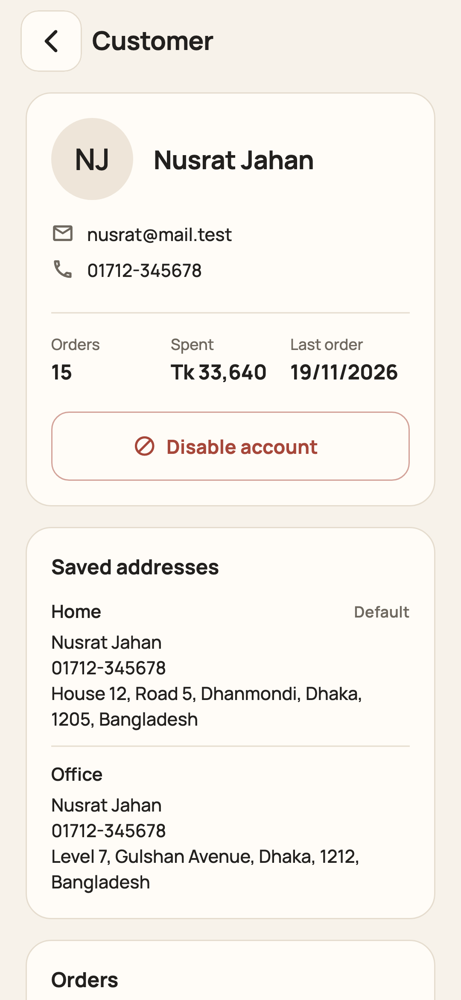
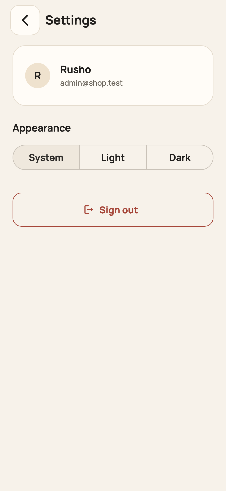
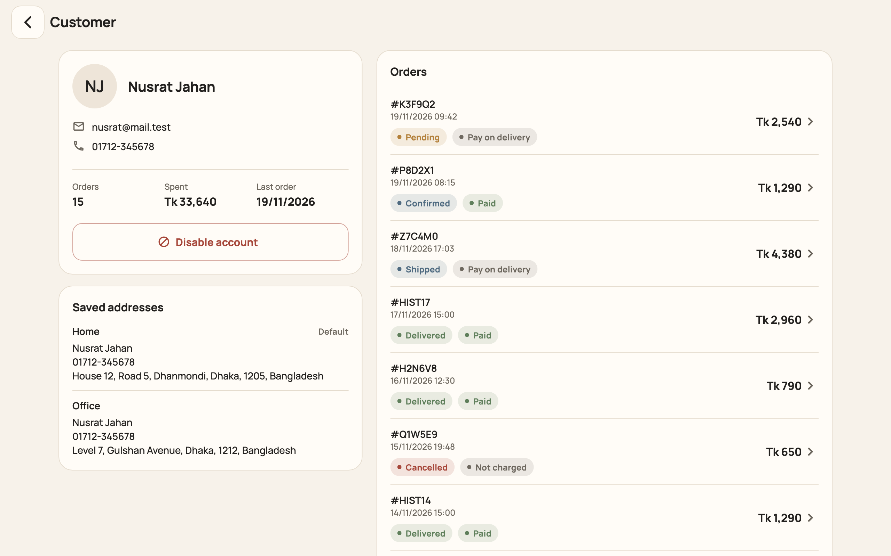
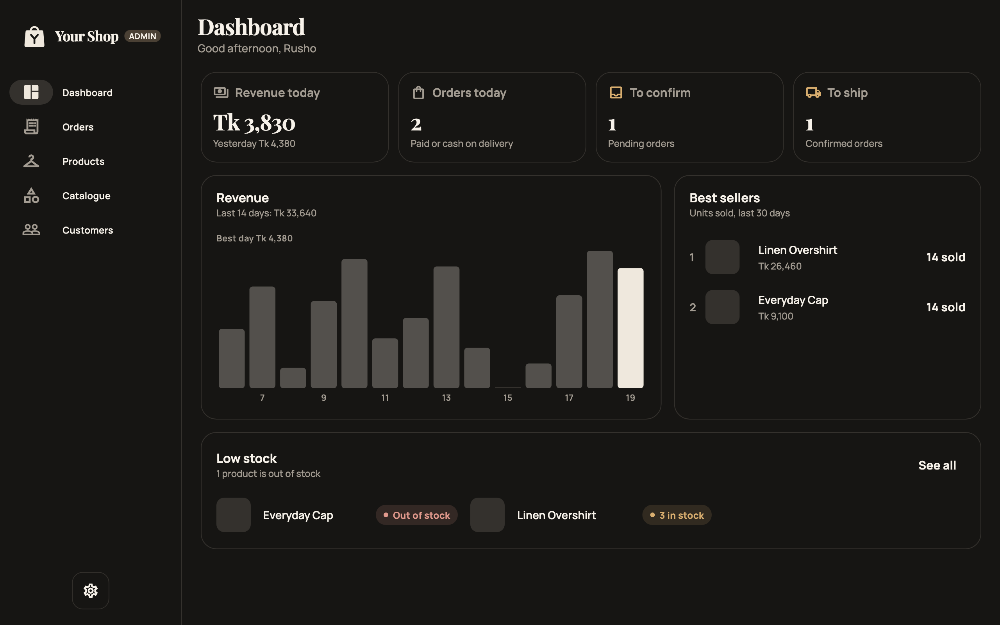

# Your Shop Admin

Admin panel for the **Your Shop** store (Bangladesh, BDT). Flutter, GetX
(MVVM), Firebase. Runs on the web, Android and iOS: tablets and browsers get
a side rail and tables, phones get a bottom bar and cards.

It shares the Firebase project `nabilrayhanshopping` with the customer app
(`UTM_clothing_app`), which owns `firestore.rules`, `storage.rules` and the
Cloud Functions. Only accounts with `users/{uid}.isAdmin == true` can sign in.


## What it does

| Area | |
|---|---|
| **Dashboard** | Revenue and orders today, orders to confirm and ship, 14-day revenue chart, best sellers (30 days), low stock |
| **Orders** | Live list with filters and search; detail with items, customer, payment, timeline; status changes; cancel with restock and refund |
| **Products** | Search and stock/category filters; create and edit with photos, sizes, stock and sale percentage; archive |
| **Catalogue** | Categories with images (rename updates products, in-use ones can't be deleted); home banners with drag-to-reorder |
| **Customers** | Search; detail with contacts, addresses, order history and totals; disable or re-enable an account |

Light and dark themes, offline banner, 48 dp tap targets and WCAG AA text
contrast (checked by tests).

| Sign in | Dashboard | Orders | Order detail |
|---|---|---|---|
|  |  |  |  |

| Products | Product form | Categories | Banners |
|---|---|---|---|
|  |  |  |  |

| Customers | Customer | Category form | Settings |
|---|---|---|---|
|  |  |  |  |





## Run

```sh
cp env/example.json env/dev.json   # git-ignored; set FUNCTIONS_BASE_URL
flutter run --dart-define-from-file=env/dev.json
flutter run -d chrome --dart-define-from-file=env/dev.json
```

Without `FUNCTIONS_BASE_URL`, everything works except cancelling orders and
disabling accounts (the buttons explain why).

## Check

```sh
dart format --output=none --set-exit-if-changed lib test tool
flutter analyze
flutter test                                              # incl. accessibility and flows
flutter test tool/screenshots_test.dart --update-goldens  # golden PNGs, look at them
```

CI (`.github/workflows/ci.yml`) runs format, analyze and tests and builds the
web app and the Android bundle on every push and pull request.

## Release

Web on Firebase Hosting (`firebase deploy --only hosting:admin`) and a signed
Android bundle: see [docs/RELEASE.md](docs/RELEASE.md). Changes:
[docs/RELEASE_NOTES.md](docs/RELEASE_NOTES.md).

## Layout

```
lib/app/      app, routes, bindings, middlewares (AdminMiddleware)
lib/core/     config, constants, errors, services, theme, utils, widgets, i18n
lib/data/     models, repositories (Firestore only, injectable fakes)
lib/modules/  <feature>/view_models, views
```

Plan and progress: [docs/ROADMAP.md](docs/ROADMAP.md).
